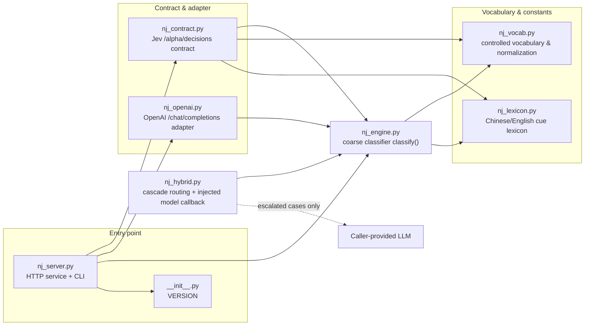
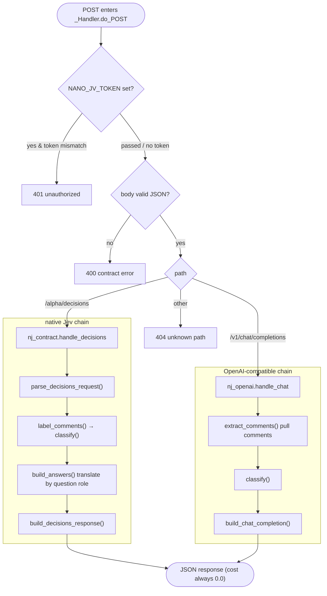

# nano_jev — a copy-anywhere Jev stand-in (deterministic coarse classifier)

> English | [中文](README.zh-CN.md)

This directory turns the idea of "give a quick coarse verdict first, escalate the hard
cases later" into a **zero-dependency, copy-anywhere** standalone service. It drops
straight into [jev-arena](https://github.com/NanmiCoder/jev-arena) as a **drop-in
replacement for Jev** on the left lane.

## What it is, and what it isn't (read this first)

| | Description |
| --- | --- |
| **Is** | A deterministic lexicon + heuristic **coarse classifier**: text and structured questions in, labels on a controlled vocabulary out. A single judgment runs in the micro-to-millisecond range, is **reproducible**, and never touches the network or a model. |
| **Isn't** | A semantic model. It scores by keyword hits, so its **accuracy ceiling is clearly below a real model** (long sentences, sarcasm, and implicit meaning in English/Chinese will be misjudged). It is positioned as "screen cheaply first" and must **not** be used as a curated conclusion. |

It shares the same philosophy as the sibling project `nano/` (a **geometric numeric
kernel**, a float32 C++ acceleration layer) but sits on a **different side and is not
interchangeable**:

* `nano/` answers "how large is this quantity, roughly?";
* `nano_jev` answers "what category does this content roughly belong to?".

This project is **zero-dependency**: no third-party packages, no dependence on `nano/`'s
C++ kernel. It can be copied wholesale onto any machine with **Python 3.9+** and run
standalone (verified on 3.9).

## Quick start

Two ways, pick one:

**A. Run directly as a script** (copy/clone the whole folder first, then run from its
**parent directory** so `nano_jev` becomes an importable package):

```bash
cd ..            # so the current directory can see the nano_jev/ folder
python3 -m nano_jev.nj_server serve --port 8765

# health check
curl -s http://127.0.0.1:8765/health

# single coarse classification
python3 -m nano_jev.nj_server label "这个模型回答准确，速度快，但价格偏贵"

# replay a decisions request (from a file or stdin)
python3 -m nano_jev.nj_server decide --file req.json
```

**B. Install as a package** (`pyproject.toml` is configured; installing adds a
`nano-jev` command):

```bash
pip install -U "setuptools>=61"   # the [project] table needs setuptools>=61; older versions silently build an empty package
pip install .                     # or pip install -e . for an editable install
nano-jev --version                # confirm which version is installed
nano-jev serve --port 8765        # equivalent to python -m nano_jev.nj_server
```

The wheel ships only the package body (8 modules + `py.typed`), not `tests/`.


## Wiring into jev-arena (two ways)

### Way 1: the native Jev protocol (left lane)

jev-arena's Jev backend reads the environment variable `OPENROUTER_BASE_URL` and appends
`/alpha/decisions` to it. Point the base URL at this service and **jev-arena needs zero
code changes**:

```bash
export OPENROUTER_BASE_URL=http://127.0.0.1:8765   # no longer point at openrouter.ai
```

It derives labels itself by calling `normalizeLabel` on the `answers` in the response.

### Way 2: the OpenAI-compatible protocol (right lane or a custom lane)

In the web UI's "model settings", configure one side as `openai` protocol, set `baseUrl`
to `http://127.0.0.1:8765/v1`, and `model` to `nano-jev`. The service extracts comments
from the user messages and returns a standard chat completion whose `content` is
`{"labels": [...]}`.

This side also aligns with official OpenAI in two ways, so most clients plug in directly:

* **Streaming**: with `"stream": true`, it switches to `text/event-stream`, pushing
  `chat.completion.chunk` frames, ending with `data: [DONE]`.
* **Candidate count `n`**: accepts `n` (1–8). Since this service is deterministic, the
  `n` candidates carry identical content; this is shape compatibility only.
* **Model discovery**: `GET /v1/models` lists models, `GET /v1/models/nano-jev` returns a single one.

## Cascading to an LLM (Hybrid)

`nano_jev` remains an independent, zero-dependency coarse classifier. The cascade
orchestrator accepts an injected LLM callback and does not bind to any provider or SDK.
By default, it escalates labels with heuristic confidence below `0.65` or `mixed`
sentiment. This score is **not a calibrated probability**; treat the default threshold as
a starting point and tune it against labeled examples from the target domain.

```python
from nano_jev import HybridPolicy, Label, judge_hybrid

def llm_judge(text: str, nano_label: Label) -> Label:
    # Call the LLM here and map its controlled structured output to Label.
    # The coarse label is a hint; the returned model label is authoritative.
    ...

result = judge_hybrid(
    "c0",
    "This model answers well at times, but it also makes things up.",
    llm_judge=llm_judge,
    policy=HybridPolicy(minimum_confidence=0.65),
)
print(result.source, result.escalation_reasons, result.label.to_raw())
```

If escalation is required but no callback was supplied, `judge_hybrid` raises
`RuntimeError` rather than presenting an unreviewed coarse result as an LLM judgment.
Model-call errors propagate by default; set `HybridPolicy(on_llm_error="nano")` to fall
back to the coarse result and record the exception type. Each result records its source,
whether it was escalated, the coarse label, LLM latency, and the escalation reasons,
making accuracy, escalation rate, latency, and token cost measurable.

Model output is not trusted as-is: `sentiment` / `intent` / `aspects` / `emotion` are
normalized to the controlled vocabulary, out-of-range `confidence` / `sentiment_score`
values are clamped, and an `evidence_quote` that is not a verbatim substring of the source
falls back to the coarse extractor's quote. Every rewrite is recorded in
`HybridResult.normalizations` and `label.meta["hybrid"]`.

Cost and batching:

```python
from nano_jev import HybridBudget, judge_many

budget = HybridBudget(limit=100)          # shared across requests
results = judge_many(
    [{"comment_id": "c0", "content": "..."}, {"comment_id": "c1", "content": "..."}],
    llm_judge=llm_judge,
    budget=budget,
)
# On exhaustion the default is to return the coarse result with a
# "budget_exhausted" reason; use HybridPolicy(on_budget_exhausted="raise")
# to fail loudly instead.
```

The default route escalates on low confidence or `mixed` sentiment. Enable
`minimum_content_length`, `escalate_irrelevant`, and `escalate_without_aspects` to widen
the escalation surface for higher-risk domains.

```text
Input → nano_jev coarse judgment → lightweight routing policy
                                    ├─ low risk → return coarse label
                                    └─ ambiguous/conflicting → injected LLM → structured label
```

## HTTP API

| Method | Path | Description |
| --- | --- | --- |
| POST | `/alpha/decisions` | Native Jev contract: `{model, state:{comments}, questions}` → `{answers, usage, …}` |
| POST | `/v1/chat/completions` | OpenAI-compatible: `{model, messages}` → standard chat completion; `"stream": true` returns `text/event-stream` incremental frames |
| GET | `/health` | Health check and version |
| GET | `/v1/models` | OpenAI-style model list |
| GET | `/v1/models/{model}` | A single model object; unknown model returns 404 |

Contract errors always return `{"error": {"message", "code"}}` (same shape as Jev's
errors). The `usage.cost` in responses is always `0.0` — a local service incurs no
provider fees, so `0` means "free", not "unknown".

Error codes at a glance:

| Status | When |
| --- | --- |
| 400 | Body is not valid JSON; `Content-Length` is not an integer or is negative |
| 401 | A token is set but `Authorization` does not match |
| 404 | Unknown path |
| 405 | Known path but wrong method; response carries an `Allow` header. **No longer** falls back to Python's default HTML 501 |
| 413 | Body exceeds 32 MiB |
| 500 | Internal error; details go only to server stderr, the client gets a generic message — no leaking exception text |

`OPTIONS` returns 204 + `Allow` for method discovery.

The request body is read according to `Content-Length`; an invalid length (non-integer or
negative) returns 400, and over 32 MiB returns 413. In both cases the body is left unread,
so the response carries `Connection: close` to avoid residual bytes polluting the next
request on the same keep-alive connection. A chunked streaming response writes its
terminating chunk whether it ends normally or fails midway, so clients never hang waiting
for the stream to finish. Binding to a non-loopback address (e.g. `--host 0.0.0.0`)
without a token prints a warning to stderr on startup — otherwise it would silently expose
an unauthenticated service to the LAN.

## Command line

```bash
python -m nano_jev.nj_server serve [--host 127.0.0.1] [--port 8765]
                                   [--topics 模型,产品] [--token <optional access token>]
python -m nano_jev.nj_server label "一段文本" [--id c0] [--stdin] [--topics ...]
python -m nano_jev.nj_server decide [--file req.json] [--topics ...]
python -m nano_jev.nj_server --version
```

`label`'s positional argument and `--stdin` are mutually exclusive; passing both errors
out (exit code 2) instead of silently preferring stdin.

`--topics` (or the environment variable `NANO_JV_TOPICS`) swaps the topic words used for
the "relevance" criterion, moving the coarse screen to another comment domain (default:
AI models/products).

`--token` (or the environment variable `NANO_JV_TOKEN`) enables authentication: once set,
every request must carry `Authorization: Bearer <token>`, and a mismatch returns 401.
If neither is set, there is no authentication (local use). Command-line arguments take
precedence over environment variables.

## Module overview

| File | Responsibility |
| --- | --- |
| `nj_vocab.py` | Controlled vocabulary and normalization, aligned item-by-item with jev-arena `vocab.mjs` |
| `nj_lexicon.py` | Bilingual (Chinese/English) polarity/intent/aspect/emotion/topic cues — the only place to extend |
| `nj_engine.py` | Coarse classifier: one text → one set of structured labels (pure function, deterministic) |
| `nj_hybrid.py` | Cascade orchestration: coarse screen → lightweight routing → optional LLM review (provider-agnostic) |
| `nj_contract.py` | Parsing and response construction for the Jev `/alpha/decisions` contract |
| `nj_openai.py` | OpenAI `/chat/completions` adapter layer (including streaming SSE) |
| `nj_server.py` | Zero-dependency HTTP service and command-line entry point |
| `tests/` | pytest tests: pure-function layer + a real-server HTTP layer |
| `pyproject.toml` | Packaging metadata + pytest / ruff / mypy configuration |

## Architecture and data flow

### Module relationships

Dependencies are one-way: **entry point → contract/adapter → engine → vocabulary**. The
two serving contract chains (native Jev, OpenAI-compatible) don't reference each other;
they share the same deterministic core `nj_engine.classify()`. `nj_hybrid` is an optional
library-level orchestrator: it uses that core and calls an injected LLM only when routing
rules request escalation. The HTTP serving endpoints remain deterministic and do not call
an LLM.



### Request handling flow

One `POST` from arrival to response: authenticate, parse JSON, route by path to one of the
two contract chains; both chains hand every comment to the same `classify()` for per-comment
coarse classification, then assemble JSON in each contract's shape. **No network, no model
call anywhere**, so identical input always yields an identical response.



## Testing

Tests live in `nano_jev/tests/` (**not** the package root: the root is the repo root, and
leaving tests there would get them bundled into the wheel by setuptools). As with running
the service, execute from the **parent directory** of `nano_jev/`:

```bash
python3 -m pytest nano_jev/ -q
```

Or run layer by layer: engine/contract/adapter are pure-function tests (no socket), while
the server tests **really start a server and make real HTTP requests**:

```bash
python3 -m pytest nano_jev/tests/test_nj_engine.py nano_jev/tests/test_nj_contract.py \
                nano_jev/tests/test_nj_openai.py nano_jev/tests/test_nj_hybrid.py -q
python3 -m pytest nano_jev/tests/test_nj_server.py -q
```

After installing, a plain `pytest` also works (configured in `pyproject.toml`).

## Development and quality configuration

`pyproject.toml` holds the packaging and tooling configuration (all targeting the same
`py39`):

```bash
pip install -e ".[dev]"     # installs pytest / ruff / mypy

ruff check .                # static checks (select E,F,W,I,N,UP,B,SIM,RUF,A)
mypy                        # type checks (no third-party deps, near-zero noise)
pytest                      # unit + end-to-end (real-server HTTP tests)
```

`.github/workflows/ci.yml` runs the same set on every push / PR (3.9–3.13 matrix), plus
two gate tasks: **build the wheel and assert its contents** (no test files in the wheel,
`py.typed` must be present) and **install from the wheel and hit the live server once**
(auth 401, method 405, decisions produce answers).

## Limitations (stated plainly)

1. **The criterion is a lexicon, not understanding**: sarcasm, long sentences, implicit
   meaning, and new words not in the lexicon will all be misjudged.
2. **Chinese substring matching has false hits**: "好" matches "好久不见" and "卡" matches
   "卡片". Chinese has no word boundaries and this subsystem deliberately avoids
   tokenization, so this cost is **kept on purpose** — acceptable for a coarse screen, not
   for a curated conclusion.
3. **Chinese first, English second**: the lexicon is predominantly Chinese; English cues
   are coarser.
4. **English matches word boundaries, but inflection coverage is limited**: pure-ASCII
   terms match on English word boundaries (`ai` no longer matches `chairman`/`rain`, `app`
   no longer matches `apple`), and common inflections like `models`/`crashed`/`slower` are
   tolerated; but irregular forms like `like`→`liking` (drop-e + ing) and new abbreviations
   not in the lexicon will still be missed.
5. **Keep the vocabulary in sync with upstream**: when jev-arena changes `vocab.mjs`,
   update `nj_vocab.py` accordingly, otherwise
   `tests/test_nj_contract.py::test_vocab_matches_jev_arena` will turn red.
