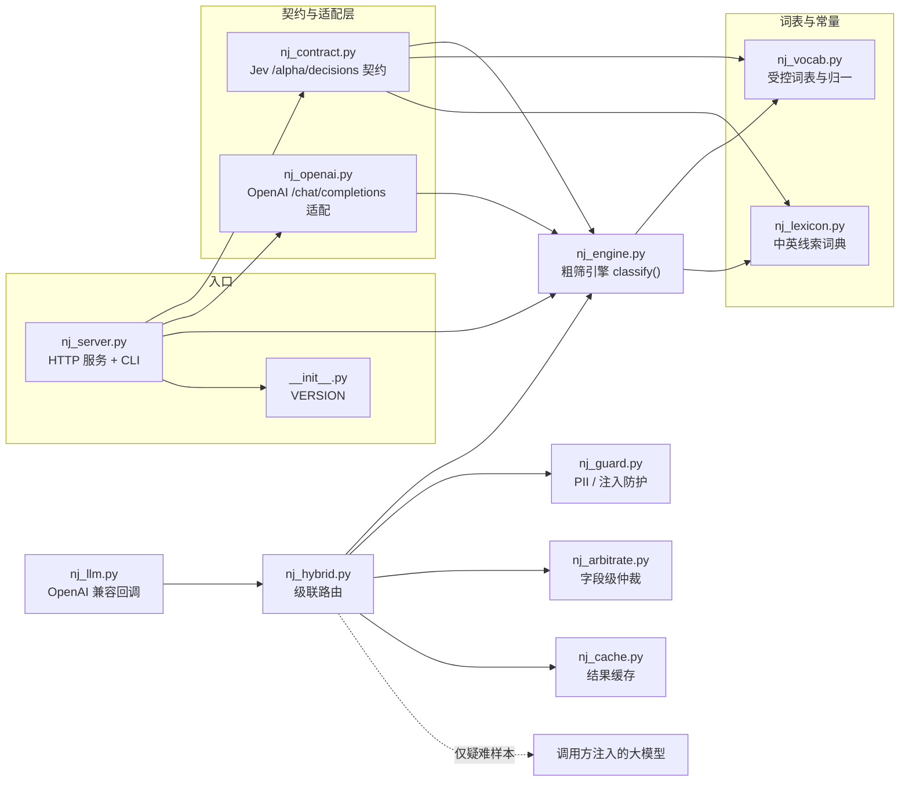
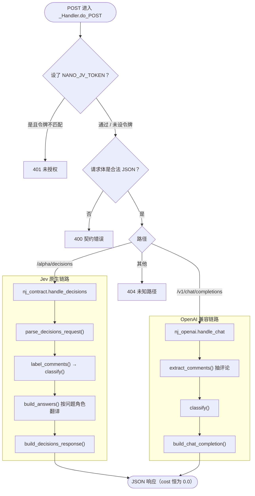

# nano_jev —— 可整包复制的 Jev 平替（确定性粗筛判断层）

> [English](README.md) | 中文

本目录把「用一次极快的粗筛先给判断、难例再升级」的思路，做成一个**零依赖、可整包
复制**的独立服务：它能直接接进 [jev-arena](https://github.com/NanmiCoder/jev-arena)
的对比场，当作左道 **Jev 的平替**跑。

## 它是什么、不是什么（先读这段）

| | 说明 |
| --- | --- |
| **是** | 确定性词典 + 启发式的**粗筛器**：输入文本与结构化问题，输出受控词表上的标签；单条判断在微秒—毫秒量级，**可复现**，不联网、不调模型。 |
| **不是** | 语义理解模型。它靠关键词命中打分，**准确率上限明显低于真模型**（英文/中文长句、反讽、隐含语义都会判错）。定位是「便宜地先筛一遍」，**不能**当作精选结论。 |

它的理念与同作者的姐妹项目 `nano/`（**几何数值内核**，float32 的 C++ 加速层）一脉
相承，但**落在不同的一侧、不可互相替代**：

* `nano/` 回答「这个数值量大约是多少」；
* `nano_jev` 回答「这条内容大概属于哪一类」。

本项目**零依赖**：不依赖任何第三方包，也不依赖 `nano/` 的 C++ 内核，可整包复制到
任意有 **Python 3.9+** 的机器上单跑（已在 3.9 上验证）。

## 快速开始

两种用法，二选一：

**A. 直接当脚本跑**（先整包复制/克隆，再在它的**父目录**运行，让 `nano_jev` 成为可
导入的包）：

```bash
cd ..            # 使当前目录下能看到 nano_jev/ 这个文件夹
python3 -m nano_jev.nj_server serve --port 8765

# 健康检查
curl -s http://127.0.0.1:8765/health

# 单条粗筛
python3 -m nano_jev.nj_server label "这个模型回答准确，速度快，但价格偏贵"

# 回放一份 decisions 请求（读文件或 stdin）
python3 -m nano_jev.nj_server decide --file req.json
```

**B. 安装成包**（`pyproject.toml` 已配好，装完多一个 `nano-jev` 命令）：

```bash
pip install -U "setuptools>=61"   # [project] 表需要 setuptools>=61；过旧会静默装出空包
pip install .                     # 或 pip install -e . 做可编辑安装
nano-jev --version                # 确认装的是哪版
nano-jev serve --port 8765        # 等价于 python -m nano_jev.nj_server
```

装出来的 wheel 只含包本体（12 个模块 + `py.typed`），不含 `tests/`。


## 接进 jev-arena（两种方式）

### 方式一：Jev 原生协议（左道）

jev-arena 的 Jev 后端读环境变量 `OPENROUTER_BASE_URL`，并在其后拼 `/alpha/decisions`。
把基址指向本服务即可，**jev-arena 无需改一行代码**：

```bash
export OPENROUTER_BASE_URL=http://127.0.0.1:8765   # 别再指向 openrouter.ai
```

它自己会从响应里的 `answers` 调 `normalizeLabel` 生成标签。

### 方式二：OpenAI 兼容协议（右道或自定义道）

在网页「模型设置」里把某一侧配成 `openai` 协议，`baseUrl` 填
`http://127.0.0.1:8765/v1`，`model` 填 `nano-jev` 即可。本服务会把用户消息里的
评论抽出来，返回一个标准 chat completion，其 `content` 是 `{"labels": [...]}`。

该侧另有两点与官方 OpenAI 对齐，便于各类客户端直接接入：

* **流式**：请求带 `"stream": true` 时，改回 `text/event-stream`，按
  `chat.completion.chunk` 逐帧推送，末帧为 `data: [DONE]`。
* **候选数 `n`**：接受 `n`（1–8）。因本服务确定，`n` 个候选内容相同，仅做形状兼容。
* **模型探测**：`GET /v1/models` 列清单，`GET /v1/models/nano-jev` 取单项。

## 与大模型级联（Hybrid）

`nano_jev` 继续作为独立的零依赖粗筛器；级联编排层由调用方注入大模型回调，不绑定
OpenAI 或其他 SDK。默认在启发式置信分低于 `0.65` 或判断为 `mixed` 时升级。该分数
不是校准概率，默认门槛只是启动值，应通过目标领域的标注集评测后调整。

```python
from nano_jev import HybridPolicy, Label, judge_hybrid

def llm_judge(text: str, nano_label: Label) -> Label:
    # 在这里调用你选用的大模型，并把受控结构化输出映射为 Label。
    # nano_label 是提示线索；升级后的标签以模型输出为准。
    ...

result = judge_hybrid(
    "c0",
    "这个模型有时答得很好，但也会编造事实",
    llm_judge=llm_judge,
    policy=HybridPolicy(minimum_confidence=0.65),
)
print(result.source, result.escalation_reasons, result.label.to_raw())
```

如果样本需要升级却没有提供模型回调，`judge_hybrid` 会抛出 `RuntimeError`，不会静默
把未经复核的粗筛结论当成模型判断。模型调用错误默认原样向上抛；设置
`HybridPolicy(on_llm_error="nano")` 才退回粗筛结果，并在结果里记录异常类型。每个结果都
带有 `source`、`escalated`、`coarse_label`、`llm_duration_ms` 与升级原因，便于离线评估
准确率、升级率、延迟和 token 成本。

模型输出不会被原样信任：`sentiment` / `intent` / `aspects` / `emotion` 会按受控词表
归一，越界的 `confidence` / `sentiment_score` 会被夹到合法区间，不在原文中的
`evidence_quote` 会退回粗筛器摘出的逐字引文。发生的规范化记录在
`HybridResult.normalizations` 与 `label.meta["hybrid"]` 中。

成本与批量：

```python
from nano_jev import HybridBudget, judge_many

budget = HybridBudget(limit=100)          # 跨请求共享升级次数
results = judge_many(
    [{"comment_id": "c0", "content": "..."}, {"comment_id": "c1", "content": "..."}],
    llm_judge=llm_judge,
    budget=budget,
)
# 预算耗尽时默认退回粗筛结果，并带 "budget_exhausted" 原因；
# 要求直接失败则设 HybridPolicy(on_budget_exhausted="raise")。
```

默认只在低置信度或 `mixed` 时升级；还可启用 `minimum_content_length`、
`escalate_irrelevant` 与 `escalate_without_aspects`，按业务风险扩大升级面。

```text
输入 → nano_jev 确定性初筛 → 轻量路由策略
                              ├─ 低风险 → 直接返回粗筛标签
                              └─ 模糊/冲突 → 注入的大模型 → 结构化标签
```

### 输入防护（PII / 注入）

```python
from nano_jev import GuardPolicy, judge_hybrid

result = judge_hybrid(
    "c0", text,
    llm_judge=judge,
    guard=GuardPolicy(max_chars=4000, injection_action="block"),  # flag / block / raise
)
```

| 能力 | 行为 |
| --- | --- |
| PII 脱敏 | 邮箱、手机号、身份证、银行卡与常见密钥替换成 `[EMAIL]` 等占位符，模型看到的是脱敏文本 |
| 截断 | `max_chars > 0` 时截断，并在结果里标记 `truncated` |
| 注入检测 | 命中"忽略以上指令 / 输出系统提示词"等中英模式；`flag` 只记录、`block` 不升级、`raise` 抛 `PromptInjectionError` |
| 包裹 | 送进模型的文本用 `<content>` 定界，定界符会被转义 |

命中与处理记录写在 `label.meta["hybrid"]["guard"]`。**它不是安全边界**：只能挡已知
措辞；真正的防线仍是"模型输出回到受控词表与原文校验"，以及不要把模型输出直接执行。

### 字段级升级与仲裁

整条升级在"只想复核某一列"时浪费预算。`review_fields` 只采纳模型的这些字段，其余
保留粗筛值；`conflict_policy` 决定冲突时保留谁：

```python
from nano_jev import HybridPolicy

policy = HybridPolicy(
    review_fields=("sentiment", "aspects"),   # 只复核情绪与维度
    conflict_policy="prefer_model",           # 或 "prefer_coarse"
)
```

每个结果的 `label.meta["arbitration"]` 记录 `fields` / `adopted` / `conflicts`。
仲裁不做"两边置信度加权平均"——两个分数都不是校准概率，平均没有可信含义。

### 缓存与并发

```python
from nano_jev import HybridCache, HybridBudget, judge_many

cache = HybridCache(namespace="local-model/prompt-v1", maxsize=2048, ttl_s=3600)
results = judge_many(
    comments, llm_judge=judge, cache=cache, budget=HybridBudget(limit=100), workers=8,
)
```

* `namespace` 必须由调用方给出（建议 `<模型>/<提示词版本>`）；留空则不缓存。
  这是为了避免换模型或改提示词后仍读到旧结论。
* 缓存只存升级后的结果，命中返回深拷贝；`stats()` 给出命中率、条目数与淘汰数。
* `judge_many(workers=N)` 并发调用模型，结果顺序与输入一致；预算的 `consume()`
  是原子的，并发下不会超发。

## 服务化（可选级联后端）

```bash
python3 -m nano_jev.nj_server serve \
    --hybrid-endpoint http://127.0.0.1:8000/v1 \
    --hybrid-model local-model \
    --hybrid-guard block \
    --hybrid-cache-namespace local-model/v1
```

* 未配置端点时，服务保持**纯确定性**：不联网、不调模型。
* 配置后，`/alpha/decisions` 与 `/v1/chat/completions`（含流式）都会先粗筛、按策略升级。
* `/health` 返回 `hybrid` 开关与缓存命中统计。
* 端点、模型与密钥也可用 `NANO_JV_LLM_ENDPOINT` / `NANO_JV_LLM_MODEL` /
  `NANO_JV_LLM_API_KEY` 提供。

库内装配见 [`examples/llm_judge_openai.py`](examples/llm_judge_openai.py)：
`OpenAICompatJudge` 只用标准库 `urllib`，可直接传给 `judge_hybrid`。

## HTTP 接口

| 方法 | 路径 | 说明 |
| --- | --- | --- |
| POST | `/alpha/decisions` | Jev 原生契约：`{model, state:{comments}, questions}` → `{answers, usage, …}` |
| POST | `/v1/chat/completions` | OpenAI 兼容：`{model, messages}` → 标准 chat completion；`"stream": true` 时回 `text/event-stream` 增量帧 |
| GET | `/health` | 健康检查、版本、级联开关与缓存统计 |
| GET | `/v1/models` | OpenAI 风格的模型清单 |
| GET | `/v1/models/{model}` | 单个模型对象；未知模型回 404 |

契约错误一律回 `{"error": {"message", "code"}}`（与 Jev 报错形状一致）。响应里的
`usage.cost` 恒为 `0.0`——本地服务不产生供应商费用，`0` 是「免费」而非「未知」。

错误码一并说明：

| 状态 | 何时 |
| --- | --- |
| 400 | 请求体非法 JSON；`Content-Length` 非整数或为负 |
| 401 | 设了令牌而 `Authorization` 不匹配 |
| 404 | 未知路径 |
| 405 | 已知路径但方法不对；响应带 `Allow` 头。**不再**落到 Python 默认的 HTML 501 |
| 413 | 请求体超过 32 MiB |
| 500 | 内部错误；详情只进服务端 stderr，对外回泛化文案，不泄露异常原文 |

`OPTIONS` 回 204 + `Allow`，便于客户端探测可用方法。

请求体按 `Content-Length` 读入，长度非法（非整数/负数）回 400、超过 32 MiB 回 413；
这两种情况都没有读走请求体，故响应会带 `Connection: close` 主动断开，避免残留字节
污染同一条 keep-alive 连接的下一个请求。分块编码的流式响应无论正常结束还是中途失败
都会写出终止块，不会让客户端一直等下去。绑到非回环地址（如 `--host 0.0.0.0`）而又
没设令牌时，启动会往 stderr 打一条警告——否则等于静默把无鉴权服务开到局域网。

## 命令行

```bash
python -m nano_jev.nj_server serve [--host 127.0.0.1] [--port 8765]
                                   [--topics 模型,产品] [--token <可选访问令牌>]
                                   [--hybrid-endpoint URL] [--hybrid-model ID]
                                   [--hybrid-guard off|flag|block|raise]
                                   [--hybrid-cache-namespace NS] [--hybrid-cache-size N]
                                   [--hybrid-cache-ttl SECONDS]
python -m nano_jev.nj_server label "一段文本" [--id c0] [--stdin] [--topics ...]
python -m nano_jev.nj_server decide [--file req.json] [--topics ...]
python -m nano_jev.nj_server --version
```

`label` 的位置参数与 `--stdin` 只能给一个，两个都给会报错退出（退出码 2），不再静默
以 stdin 为准。

`--topics`（或环境变量 `NANO_JV_TOPICS`）用于换掉「相关性」判据的主题词表，把粗筛
搬到别的评论域（默认是 AI 模型/产品）。

`--token`（或环境变量 `NANO_JV_TOKEN`）用于开启鉴权：设了之后所有请求须带
`Authorization: Bearer <token>`，不匹配回 401；两者都不给则不鉴权（本地使用）。
命令行参数优先于环境变量。

## 模块一览

| 文件 | 负责什么 |
| --- | --- |
| `nj_vocab.py` | 受控词表与归一，与 jev-arena `vocab.mjs` 逐项对齐 |
| `nj_lexicon.py` | 中英双语的极性/意图/维度/情绪/主题线索（唯一需要扩充的地方） |
| `nj_engine.py` | 粗筛引擎：一条文本 → 一套结构化标签（纯函数、确定性） |
| `nj_hybrid.py` | 级联编排：初筛 → 轻量路由 → 可选的大模型复核（供应商无关） |
| `nj_guard.py` | 输入防护：PII 脱敏、注入检测、不可信内容包裹 |
| `nj_arbitrate.py` | 字段级升级与冲突仲裁 |
| `nj_cache.py` | 线程安全的 LRU 缓存（命名空间 + TTL） |
| `nj_llm.py` | OpenAI 兼容判断器（标准库 urllib）与标签构造 |
| `examples/` | 供应商适配示例（不随 wheel 分发） |
| `nj_contract.py` | Jev `/alpha/decisions` 契约的解析与响应构造 |
| `nj_openai.py` | OpenAI `/chat/completions` 适配层（含流式 SSE） |
| `nj_server.py` | 零依赖 HTTP 服务与命令行入口 |
| `tests/` | pytest 测试：纯函数层 + 真起服务的 HTTP 层 |
| `pyproject.toml` | 打包元数据 + pytest / ruff / mypy 配置 |

## 架构与数据流

### 模块关系

依赖是单向的：**入口 → 契约/适配 → 引擎 → 词表**。两条契约链路（Jev 原生、OpenAI
兼容）互不引用，只共享同一个确定性核心 `nj_engine.classify()`；`nj_vocab` / `nj_lexicon`
是被依赖的叶子，也是唯一需要跟随上游扩充的地方。级联相关模块只在被显式调用时
才参与：`nj_guard`（输入防护）→ `nj_hybrid`（路由）→ `nj_arbitrate`（字段仲裁），
`nj_cache` 与 `nj_llm` 是可选的横切件。



### 请求处理流程

一次 `POST` 从进服务到出响应：先鉴权、再解析 JSON、按路径分流到两条契约链路；默认
两条链路都把评论交给同一个 `classify()` 逐条粗筛，最后拼成各自契约形状的 JSON。**默认
全程无网络、无模型调用**，故同样输入必然得到同样响应。配置 `--hybrid-endpoint` 后，
路由才会在疑难样本上调用一次模型；响应形状不变。



## 测试

测试放在 `nano_jev/tests/`（**不是**包根：包根即仓库根，测试留在那里会被
setuptools 一起打进 wheel）。与运行服务一样，在 `nano_jev/` 的**父目录**执行：

```bash
python3 -m pytest nano_jev/ -q
```

也可按层分开跑：引擎/契约/适配是纯函数测试（不碰 socket），服务端测试会**真起服务、
真发 HTTP**：

```bash
python3 -m pytest nano_jev/tests/test_nj_engine.py nano_jev/tests/test_nj_contract.py \
                nano_jev/tests/test_nj_openai.py nano_jev/tests/test_nj_hybrid.py \
                nano_jev/tests/test_nj_guard.py nano_jev/tests/test_nj_arbitrate.py \
                nano_jev/tests/test_nj_cache.py nano_jev/tests/test_nj_llm.py -q
python3 -m pytest nano_jev/tests/test_nj_server.py -q
```

安装后也可直接 `pytest`（配置见 `pyproject.toml`）。

## 开发与质量配置

`pyproject.toml` 里统一放了打包与工具配置（都用同一套 `py39` 目标）：

```bash
pip install -e ".[dev]"     # 装 pytest / ruff / mypy

ruff check .                # 静态检查（select E,F,W,I,N,UP,B,SIM,RUF,A）
mypy                        # 类型检查（无第三方依赖，近乎零噪音）
pytest                      # 单元 + 端到端（真起服务的 HTTP 测试）
```

`.github/workflows/ci.yml` 在每次 push / PR 上跑同一套（3.9–3.13 矩阵），另加两个
守门任务：**构建 wheel 并断言包内容**（测试文件不得进 wheel、`py.typed` 必须在）、
**从 wheel 安装后真起服务打一轮 HTTP**（鉴权 401、方法 405、decisions 出答案）。

## 局限（如实写清）

1. **判据是词典，不是理解**：反讽、长句、隐含语义、词典未覆盖的新词都会判错。
2. **中文子串匹配会有误命中**：「好」会命中「好久不见」，「卡」会命中「卡片」。中文
   没有词边界、本子系统又不引入分词依赖，这条代价是**刻意留下**的——对粗筛可接受，
   不可当精选结论。
3. **中文优先、英文次之**：词典以中文为主，英文线索较粗。
4. **英文按词边界匹配，但屈折覆盖有限**：纯 ASCII 词条按英文词边界匹配（`ai` 不再
   命中 `chairman`／`rain`，`app` 不再命中 `apple`），并容忍 `models` / `crashed` /
   `slower` 这类常见屈折；但 `like`→`liking` 这种去 e 加 ing 的不规则形式、以及词典
   未收录的新缩写仍会漏。
5. **词表如需与上游保持同步**：jev-arena 改 `vocab.mjs` 时要同步改 `nj_vocab.py`，
   否则 `tests/test_nj_contract.py::test_vocab_matches_jev_arena` 应报红。
